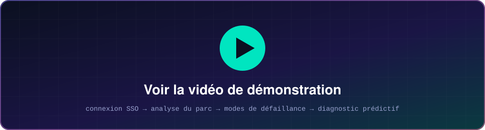
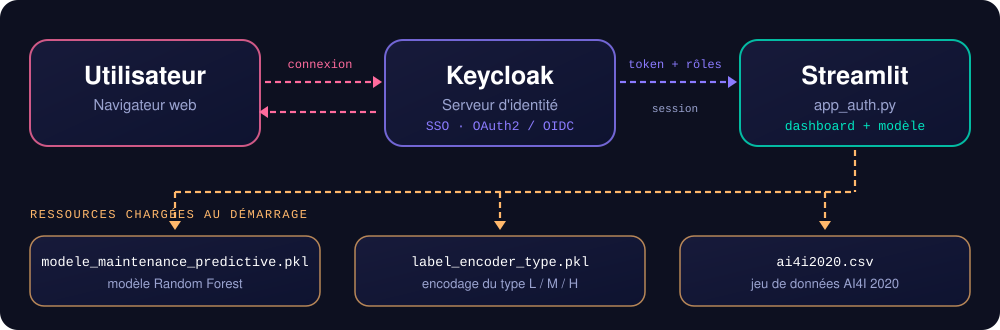

<div align="center">



<br/>


<br/><br/>

**Capteurs → modèle Random Forest → probabilité de panne → action de maintenance**

*Projet de [Siwar Mrayhi](https://github.com/siwarmrayhi).*

</div>

<br/>



---

## 📌 Vue d'ensemble

**MetaSafe Industrial** est un tableau de bord interactif de **maintenance prédictive** (application *Industrial AI Insights*), construit sur le jeu de données **AI4I 2020 Predictive Maintenance**.

Il permet de :

- **explorer** la santé d'un parc de machines (indicateurs, distributions, corrélations) ;
- **comprendre** les cinq modes de défaillance et les variables qui les provoquent ;
- **diagnostiquer** une machine : à partir de ses paramètres capteurs, un modèle **Random Forest** estime sa **probabilité de panne** et le tableau de bord recommande une action.

L'accès à l'application est protégé par une **authentification unique (SSO) Keycloak**.

## 🎬 Démonstration vidéo

<div align="center">

<!-- Remplacez VOTRE_LIEN_GOOGLE_DRIVE par le lien de votre vidéo -->
<a href="VOTRE_LIEN_GOOGLE_DRIVE">
  
</a>

</div>

## 📑 Sommaire

- [Fonctionnalités](#-fonctionnalités)
- [Pages de l'application](#-pages-de-lapplication)
- [Modes de défaillance](#-modes-de-défaillance)
- [Diagnostic prédictif](#-diagnostic-prédictif)
- [Architecture](#-architecture)
- [Authentification Keycloak](#-authentification-keycloak)
- [Structure du projet](#-structure-du-projet)
- [Installation et lancement](#-installation-et-lancement)
- [Limites et pistes d'amélioration](#-limites-et-pistes-damélioration)
- [Technologies utilisées](#-technologies-utilisées)

---

## ✨ Fonctionnalités

| | Fonctionnalité | Ce qu'elle apporte |
|:-:|---|---|
| 🏭 | **Indicateurs du parc** | Parc total, pannes, disponibilité, usure moyenne des outils et couple moyen, avec filtre par type de machine (L / M / H). |
| 📊 | **Analyse des capteurs** | Histogrammes, courbes de densité (KDE), box plots et violons comparant les machines saines et en panne, avec le **d de Cohen** comme mesure du pouvoir discriminant. |
| 🔬 | **Analyse multivariée** | Matrice de corrélation, carte des zones de stress mécanique (couple et vitesse), différence de température et puissance mécanique. |
| ⚠️ | **Modes de défaillance** | Tableau de synthèse et analyse approfondie de chacun des cinq modes (TWF, HDF, PWF, OSF, RNF), avec explication métier. |
| 🤖 | **Diagnostic prédictif** | Saisie de six paramètres, jauge de probabilité de panne, verdict à trois niveaux et facteurs de risque détaillés. |
| 🔐 | **SSO Keycloak** | Connexion OAuth2 / OIDC, rôle de l'utilisateur affiché dans l'application, déconnexion qui invalide la session côté serveur. |
| 🌙 | **Interface soignée** | Thème sombre, palette cohérente (vert sain, orange alerte, rouge panne) et encadrés d'interprétation générés automatiquement. |

---

## 🧭 Pages de l'application

Cinq pages, accessibles depuis le menu latéral. Les filtres globaux (type de machine) s'appliquent aux quatre pages d'analyse.

| Page | Contenu |
|---|---|
| **🏠 Vue d'ensemble** | Cinq indicateurs clés, répartition sain / panne, taux de panne par type de machine, décomposition des modes de défaillance. |
| **📊 Distribution & comportement** | Choix d'une variable capteur : statistiques comparées, histogramme, courbe de densité, box plot et violon par type. |
| **🔬 Analyse multivariée** | Corrélations de Pearson, zones de stress mécanique, ΔT (process − air) et puissance mécanique. |
| **⚠️ Modes de défaillance** | Synthèse des cinq modes, profil moyen des machines en panne pour le mode choisi, explication et action recommandée. |
| **🤖 Diagnostic prédictif** | Formulaire de saisie, jauge de risque, verdict, analyse des facteurs de risque et comparaison avec la moyenne du parc. |

---

## 🔥 Modes de défaillance

Le jeu de données AI4I 2020 distingue cinq modes de panne. L'application les analyse un par un et s'appuie sur leurs seuils pour expliquer le risque d'une machine.

<div align="center">

</div>

---

## 🤖 Diagnostic prédictif

La page de diagnostic transforme les mesures d'une machine en une **probabilité de défaillance**, estimée par un modèle **Random Forest** entraîné sur AI4I 2020.

**Entrées**

| Paramètre | Plage proposée |
|---|---|
| Type de machine | L (Low), M (Medium), H (High quality) |
| Température de l'air | 295 – 305 K |
| Température du process | 305 – 315 K |
| Vitesse de rotation | 1000 – 3000 RPM |
| Couple | 0 – 80 Nm |
| Usure de l'outil | 0 – 300 min |

**Sortie** : une jauge de probabilité de panne et un verdict.

| Probabilité | Verdict | Action recommandée |
|:-:|---|---|
| < 30 % | ✅ Machine opérationnelle | Maintenir la surveillance standard. |
| 30 – 60 % | ⚠️ Risque modéré | Renforcer le monitoring, planifier une inspection. |
| ≥ 60 % | 🚨 Risque élevé | Programmer immédiatement une intervention de maintenance. |

L'application affiche aussi un **risque par facteur** (usure d'outil, dissipation de chaleur, surcharge énergétique, sur-contrainte) pour indiquer ce qui menace le plus la machine.

---

## 🧱 Architecture

<div align="center">

</div>

L'application Streamlit charge une seule fois, au démarrage, trois ressources : le **modèle** Random Forest, l'**encodeur** du type de machine et le **jeu de données**. L'utilisateur ne voit l'application qu'après s'être authentifié auprès du serveur Keycloak.

---

## 🔐 Authentification Keycloak

L'authentification repose sur **Keycloak** (OAuth2 / OIDC) via la bibliothèque `streamlit-keycloak`. Tant que l'utilisateur n'est pas connecté, le reste de l'application ne se charge pas.

Le rôle affiché dans l'application est déduit du champ `roles` renvoyé par Keycloak :

| Rôle Keycloak | Rôle affiché |
|---|---|
| `admin` | Administrateur |
| `analyste` | Analyste |
| autre | Opérateur |

<details>
<summary><b>Configuration des secrets</b></summary>

<br/>

L'application lit trois valeurs dans les secrets Streamlit :

```toml
[keycloak]
url = "https://ton-serveur-keycloak.com"
realm = "industrial-realm"
client_id = "industrial-ai-insights"
```

Un modèle est fourni dans `secrets_template.toml`. En local, placez ce contenu dans `.streamlit/secrets.toml`. Sur Streamlit Community Cloud, ajoutez-le dans **Settings > Secrets** de l'application.

Sans cette configuration, l'application affiche un message d'erreur explicite et s'arrête.

</details>

---

## 📁 Structure du projet

```text
MetaSafe-Industrial/
├── app_auth.py                        Application Streamlit (authentification + dashboard)
├── entrainement.ipynb                 Notebook d'entraînement du modèle
├── modele_maintenance_predictive.pkl  Modèle Random Forest entraîné
├── label_encoder_type.pkl             Encodeur du type de machine (L / M / H)
├── ai4i2020.csv                       Jeu de données AI4I 2020
├── secrets_template.toml              Modèle de configuration Keycloak
├── requirements.txt                   Dépendances Python
└── docs/
    └── assets/                        Visuels de ce README
```

---

## 🚀 Installation et lancement

### Prérequis

- Python 3
- Un serveur **Keycloak** accessible, avec un realm et un client configurés pour l'application
- Les rôles `admin` et `analyste` dans Keycloak, exposés dans le champ `roles` des informations utilisateur (sinon l'utilisateur est considéré comme Opérateur)

### Lancement en local

```bash
git clone https://github.com/siwarmrayhi/MetaSafe-Industrial.git
cd MetaSafe-Industrial

python -m venv venv
source venv/bin/activate         # Windows : venv\Scripts\activate
pip install -r requirements.txt
```

Configurez ensuite les secrets Keycloak (voir [Authentification Keycloak](#-authentification-keycloak)), puis lancez l'application :

```bash
streamlit run app_auth.py
```

L'application s'ouvre dans le navigateur et redirige vers la page de connexion Keycloak.

---

## 🚧 Limites et pistes d'amélioration

| Limite | Piste |
|---|---|
| AI4I 2020 est un jeu de données **synthétique** : les résultats ne garantissent pas les mêmes performances sur des machines réelles. | Valider et réentraîner le modèle sur des données de terrain. |
| Le rôle de l'utilisateur est affiché, mais ne restreint pas encore l'accès aux pages. | Limiter certaines pages ou actions selon le rôle Keycloak. |
| Le diagnostic porte sur une machine saisie à la main. | Alimenter le diagnostic en continu par des capteurs ou un flux de données. |

---

## 🧰 Technologies utilisées

<div align="center">

</div>

---

<div align="center">

## 👩‍💻 Auteure

**Siwar Mrayhi**

<a href="https://github.com/siwarmrayhi"></a>
<a href="https://linkedin.com/in/siwar-mrayhi"></a>

</div>
